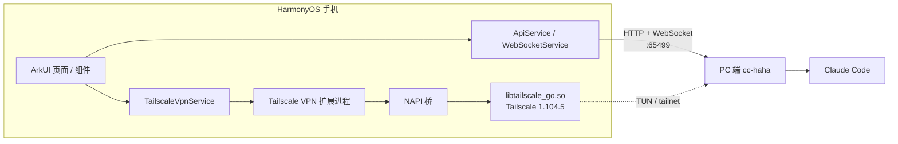

# cc-haha-mobile for HarmonyOS

<p align="center">
  
</p>

<p align="center">
  <b>在 HarmonyOS 手机上使用 Claude Code</b><br/>
  cc-haha 的鸿蒙原生客户端：会话管理、流式聊天、工具调用、权限模式切换，并可选内置 Tailscale 实现外网访问。
</p>

<p align="center">
  
  
  
</p>

> 非官方项目，与 Anthropic、Tailscale Inc. 均无关联或背书关系。
>
> 本仓库只是**手机客户端**，需要 PC 端 cc-haha 提供服务；不包含 PC 服务端。

## 功能

- **微信式会话**：会话列表为首页，点击进入独立聊天页；前台每 30 秒自动刷新。
- **流式聊天**：Markdown、思考过程、工具调用卡片默认收起；支持整轮折叠、轮次导航、回到最新。
- **历史记录**：本地缓存优先上屏，再按游标分页拉取服务端增量；断线重连后自动补拉。
- **工具栏**：权限模式（询问/自动接受/计划/跳过/不询问）、工作目录、上下文占用、模型选择、思考强度。
- **附件**：从相册或文件选择器发送图片和文件。
- **通知**：后台回复完成通知与摘要；生成中离开聊天页会由后台监听器接管，完成后仍能提醒。
- **连接稳定性**：心跳 + pong 超时、无限自动重连、前台恢复探活、断线禁止发送。
- **多地址切换**：主地址 + 备用地址（典型组合为局域网 IP + Tailscale IP），并行探测并自动切换。
- **快速配对**：扫码、剪贴板导入、粘贴 H5 链接或手动填写。
- **内置 Tailscale**：从源码构建的 Tailscale 1.104.5，冷启动自动连接 tailnet，无需额外安装 VPN App。
- **深色模式**：跟随设置页开关。

## 架构



- `pages/`、`components/`：ArkUI 界面。
- `services/`：REST、WebSocket、配置、历史缓存、通知、后台任务、Tailscale 控制。全局实例在 `EntryAbility.onCreate` 中创建并写入 `AppStorage`。
- `entry/src/main/cpp/`：NAPI 桥 `tailscale_ohos_bridge`，仅供 VPN 扩展进程加载。
- `entry/libs/arm64-v8a/`：预编译的 `libtailscale_go.so`（Git LFS）与 `libc++_shared.so`。

## 环境要求

| 端 | 要求 |
|---|---|
| PC | 已安装并运行 cc-haha，开启 H5 访问；默认端口 `65499`；与手机在同一局域网或同一 Tailscale tailnet |
| 手机 | HarmonyOS NEXT 手机/平板，`compatibleSdkVersion 6.1.0(23)`，arm64；实测 HarmonyOS 7.0 / API 26 |
| 构建 | DevEco Studio 6.1.1（自带 Node / JBR / hvigor） |

## 快速开始

### 1. 准备 PC 端 cc-haha

1. 打开 cc-haha 设置，启用 **H5 访问**，复制 H5 链接或二维码（包含 `serverUrl` 与 `h5Token`）。
2. 确认监听端口为 `65499`（`fixedPort`）。
3. 把手机可能用到的地址加入 `h5Access.allowedOrigins`：

```json
{
  "fixedPort": 65499,
  "h5Access": {
    "enabled": true,
    "token": "<H5_TOKEN>",
    "allowedOrigins": ["http://192.168.1.20", "http://100.64.0.1"]
  }
}
```

> `allowedOrigins` 里的地址**不带端口**。HarmonyOS WebSocket 自动发送的 Origin 是 `http://<host>`，与浏览器不同；漏配会表现为 REST 正常但 WebSocket 连不上。

4. 可选：在 PC 上安装并登录 Tailscale，把它的 `100.x.x.x` 地址作为手机端备用地址。

连通性自检：

```bash
curl http://<PC_IP>:65499/health
# {"status":"ok"}
```

### 2. 安装客户端

#### 方式 A：DevEco Studio 自动签名（推荐）

1. 从 [Releases](https://github.com/KOTMMMMM/cc-haha-mobile-for-harmony/releases) 下载未签名 HAP。
2. 用 DevEco Studio 打开 `harmony-app`，登录华为账号。
3. **File → Project Structure → Signing Configs**，勾选「Automatically generate signature」，点击「应用」→「确定」。
4. 在 `harmony-app/build-profile.json5` 的 `products[0]` 中加上 `"signingConfig": "default"`（只勾选不会自动绑定）。
5. 手机开启开发者模式和 USB 调试，连接后点击 Run。

调试签名 profile 会绑定设备 UDID，换设备需要重新生成；预签名 HAP 不能直接分享给别人。

#### 方式 B：命令行构建 + 签名 + 安装

```bash
export DEVECO_HOME="/path/to/DevEco Studio"
export NODE_HOME="$DEVECO_HOME/tools/node"
export JAVA_HOME="$DEVECO_HOME/jbr"
export PATH="$NODE_HOME:$JAVA_HOME/bin:$PATH"
export DEVECO_SDK_HOME="$DEVECO_HOME/sdk"

cd harmony-app
node "$DEVECO_HOME/tools/hvigor/bin/hvigorw.js" assembleHap --no-daemon
```

签名（hvigor 不接受明文密码，使用官方 `hap-sign-tool`）：

```bash
java -jar "$DEVECO_HOME/sdk/default/openharmony/toolchains/lib/hap-sign-tool.jar" sign-app \
  -mode localSign \
  -keyAlias "<alias>" -keyPwd "<keystore 密码>" \
  -appCertFile "<cert.cer>" \
  -profileFile "<profile.p7b>" \
  -inFile entry/build/default/outputs/default/entry-default-unsigned.hap \
  -signAlg SHA256withECDSA \
  -keystoreFile "<keystore.p12>" -keystorePwd "<keystore 密码>" \
  -outFile entry/build/default/outputs/default/entry-default-signed.hap \
  -compatibleVersion 23 -pwdInputMode 0
```

安装：

```bash
hdc install -r entry/build/default/outputs/default/entry-default-signed.hap
```

也可以使用脚本（签名材料默认放在仓库外 `~/.cc-haha-signing/`）：

```bash
KEY_PWD='<keystore 密码>' STORE_PWD='<keystore 密码>' tools/build-sign-install.sh
```

完整说明（含新包名签名、第三方侧载工具、常见错误）见 **[INSTALL.md](INSTALL.md)**。

### 3. 配对并连接 PC

首次启动进入配对页，任选一种方式：

- **扫码配对**：扫描 cc-haha 展示的 H5 二维码。支持 H5 链接或 JSON（`{host, port, token, alt}`）。
- **从剪贴板导入**：把 H5 链接复制到手机剪贴板后点按导入。
- **手动填写**：填入 PC 地址、端口、H5 Token；可选填备用地址与 Origin。

点击连接后，客户端会先请求 `/health` 再校验 token。成功后自动保存配置并进入会话列表。

- 主地址填当前网络下最常用的地址，备用地址填另一个网络下的地址（例如主地址局域网、备用地址 Tailscale）。
- 连接、刷新时会并行探测所有地址，自动选择可达的那个。
- 顶部横幅会显示当前连接状态与实际使用的地址。

### 4. 日常使用

- 会话列表：点击任意会话进入聊天页；右上角可新建会话。
- 聊天页：输入框上方工具栏可切换权限模式、模型、思考强度，查看工作目录和上下文占用。
- 通知：设置页可开启「回复完成通知」；首次使用需允许系统通知权限。
- 设置页：主题、模型、通知开关、重新配对、Tailscale 与退出登录。

### 5. 可选：内置 Tailscale

1. 设置页打开 **内置 Tailscale**。
2. 首次使用需要登录，三种方式任选：
   - 设置页「应用内登录」，在 App 内 WebView 完成 Tailscale 授权；
   - 在 Tailscale 管理后台生成 `tskey-auth-...`，粘贴到设置页的 Auth Key 输入框；
   - 使用扩展给出的登录链接在浏览器打开。
3. 登录成功后扩展进入 `running`，冷启动会自动恢复连接，不需要重复登录。
4. 把 PC 的 Tailscale IP 填入配对页的主地址或备用地址，即可在蜂窝网络下访问。

注意事项：

- 内置 Tailscale 会占用系统 VPN 通道，与 ClashBox 等 VPN 不能同时开启（错误码 `2203002`）。
- 只建立 tailnet 路由，不接管默认路由；不支持 exit node、MagicDNS、Taildrop/Taildrive。
- 卸载 App 会删除 Tailscale 登录态；`hdc install -r` 覆盖安装通常保留。
- 从旧包名 `com.claudehaha.mobile` 升级到 `com.cchaha.harmony` 属于全新安装，数据不会迁移。

## 常见问题

| 现象 | 处理 |
|---|---|
| 一直显示缓存 / `Invalid URL` | 确认手机当前网络能访问 PC；等 Tailscale 进入 `running` 后会自动重试 |
| REST 正常但 WebSocket 连不上 | 检查 `h5Access.allowedOrigins` 是否包含 `http://<host>`（不带端口） |
| 连接失败：认证失败 | H5 Token 错误或已重新生成；重新复制链接配对 |
| 创建 VPN 失败 `2203002` | 先断开系统里其他 VPN（如 ClashBox），再开启内置 Tailscale |
| Tailscale 状态「无响应」 | 心跳过期会自动重启（2/4/8/16/30 秒退避）；也可在设置页点「重启」 |
| 扫码后连不上 | 二维码里的地址可能只在局域网可用；补充 Tailscale 备用地址 |
| 安装提示签名不一致 | 使用同一份签名材料，或卸载旧包后重装（会清除 App 数据） |
| 通知不显示 | 在系统设置中允许「cc-haha」通知，并确认设置页开关已打开 |
| 权限弹窗不出现 | 服务端自动放行时不会下发 `permission_request`，属于服务端行为 |
| 回复很慢 | 检查会话上下文占用；超大会话建议新开会话 |

更多排查见 [INSTALL.md](INSTALL.md)。

## 目录结构

```
harmony-app/                    HarmonyOS 应用（ArkTS + NAPI）
  entry/src/main/ets/           页面、组件、服务、模型
  entry/src/main/cpp/           libtailscale_ohos_bridge NAPI 桥
  entry/libs/arm64-v8a/         预编译 libtailscale_go.so（Git LFS）
docs/legacy/pc-bridge/          已废弃的独立桥接参考实现（旧协议，不参与构建）
docs/toolchain.md               Tailscale 原生库构建记录
docs/blog/                      技术文章与发布草稿
tools/                          构建 + 签名 + 安装、密钥扫描、单测、协议 smoke
INSTALL.md                      安装、配对与常见问题
THIRD_PARTY_NOTICES.md          第三方组件许可（完整文本见 licenses/）
```

## 开发与测试

```bash
# 纯逻辑单测（历史合并、消息解析等）
cd tools/unit-tests && npm test

# REST 协议 smoke（需要 PC 端可达并配置 token）
node tools/smoke-test.mjs

# 提交前密钥扫描
tools/check-secrets.sh
git config core.hooksPath .githooks
```

- 克隆后先 `git lfs install` 和 `git lfs pull`，否则 `libtailscale_go.so` 只是指针文件。
- 原生库只提供 `arm64-v8a`，模拟器（x86_64）无法运行内置 Tailscale。
- 更换 `libtailscale_go.so` 后需同步更新 `entry/libs/arm64-v8a/SHA256SUMS`。
- Tailscale 原生库的构建版本、API 24/26 兼容说明见 [docs/toolchain.md](docs/toolchain.md)。

## 已知限制

- 未做应用商店合规，只适合自行签名侧载；调试 profile 与设备 UDID 绑定。
- 内置 Tailscale 仅支持自动连接 tailnet，不支持 exit node、MagicDNS、Taildrop。
- 与其它系统 VPN 互斥。
- 超大会话（数千条消息、上下文接近上限）首次响应可能很慢。
- 服务端自动放行权限时，客户端不会出现权限确认弹窗。

## 安全与合规

- H5 Token 等同于 PC 端访问凭证，不要截图外泄或提交到仓库。
- `signing/`、证书、profile、密码、`test-artifacts/`、构建产物均已加入 `.gitignore`。
- 签名密码只通过 `KEY_PWD` / `STORE_PWD` 环境变量传入。
- 内置 Tailscale 属于 VPN 能力，公开分发或上架前请自行评估合规要求。
- 本仓库原创代码采用 MIT 许可证；随包分发的第三方组件保留各自许可证。

## 技术文章

- [把 Tailscale 搬进鸿蒙：从 go-ohos 交叉编译到 VPN 扩展的完整踩坑](docs/blog/2026-11-14-tailscale-ohos-port.md)

## 贡献

欢迎提交 Issue 和 PR。涉及原生库或连接协议的改动，请先阅读 [docs/toolchain.md](docs/toolchain.md) 并在真机上验证。

如果这个项目对你有帮助，欢迎点一个 Star 支持。

## License

MIT © 2026 KOTMMMMM

第三方组件（Tailscale、Go、MeshArc、LLVM libc++ 等）保留其原有许可证，详见 `THIRD_PARTY_NOTICES.md` 与 `licenses/`。
