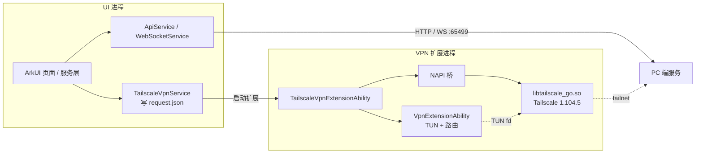

# 把 Tailscale 搬进鸿蒙：从 go-ohos 交叉编译到 VPN 扩展的完整踩坑

> 副标题：一次把 Tailscale 1.104.5 从源码带进 HarmonyOS NEXT 的实践记录
>
> 项目背景：给 PC 端的 Claude Code 封装做一个鸿蒙手机客户端，希望在蜂窝网络下也能直接连回家里电脑，不想依赖 Android 兼容层里的另一个 Tailscale。
>
> 说明：本文是个人项目实践，非 Tailscale / Anthropic 官方内容。文中命令与路径做了脱敏，完整记录见仓库 `docs/toolchain.md`。

## 0. 为什么要自己编译 Tailscale

手机客户端需要访问 PC 上的本地 HTTP/WebSocket 服务。局域网内直接填 IP 就行，但出门在外就需要一条稳定的 overlay 网络。

一开始的方案是在卓易通（Android 兼容环境）里跑 Android 版 Tailscale，再把流量转给鸿蒙应用。实际用下来问题不少：

- 多一层兼容环境，启动和保活都不可控；
- 系统 VPN 通道被兼容层占用，状态不透明；
- 应用自身流量不一定走隧道，需要额外配置；
- 无法做到“打开 App 就自动连上 tailnet”。

鸿蒙没有官方 Tailscale 客户端。于是目标变成：**把 Tailscale 的 Go 后端编译成 OHOS 的 arm64 动态库，通过 NAPI 暴露给一个 VPN 扩展进程，由扩展进程持有 TUN 和路由**。

## 1. 架构总览

最终方案有两个进程：



关键点：

- **UI 进程不加载 native 库**，只负责写请求文件、轮询状态文件。
- **VPN 扩展进程独家持有 Go 后端**，负责 TUN、路由、登录和网络变化。
- Go 后端通过 NAPI 暴露为 Promise API，扩展进程用 ArkTS 调用。
- 两个进程通过应用沙箱里的 `request.json` / `status.json` 通信，避免跨进程 RPC 的复杂度。

## 2. go-ohos：让 Go 能产出 OHOS 动态库

Go 官方没有 OHOS 目标。这里使用的是社区维护的 `flypigJ/go-ohos` 与 `flypigJ/tailscale-ohos-core`。

### 2.1 工具链 bootstrap

| 组件 | 版本 / 提交 |
|---|---|
| Go bootstrap | 官方 1.27.3 |
| `flypigJ/go-ohos` | `9f8bcc7`，bootstrap 出 `go1.27.3-ohos-devel` |
| `flypigJ/tailscale-ohos-core` | Tailscale 1.104.5，上游 `73a4805`，已 prepare 并应用 patches |
| DevEco Studio | 6.1.1 |
| HarmonyOS native SDK | 要求 API 26 Release（本机只有 API 24） |

流程是：

1. 用官方 Go 1.27.3 作为 bootstrap，编译 `go-ohos` 的 OHOS 目标，得到 `go1.27.3-ohos-devel`；
2. 用这套 Go 工具链编译 `tailscale-ohos-core`，产出 `libtailscale_go.so`；
3. 用 `llvm-strip --strip-debug` 瘦身，最终约 26MB，导出 41 个 `TS*` C ABI 函数。

构建命令大致如下：

```bash
cd tailscale-ohos-core
python scripts/manage.py build \
  --go-root /path/to/go-ohos \
  --sdk "$DEVECO_HOME/sdk/default/openharmony/native"
```

产物：

- `out/arm64-v8a/libtailscale_go.so`
- `libtailscale_go.h`
- `build.json`

### 2.2 SDK 版本偏差

上游脚本要求 `apiVersion == 26`。本机 DevEco 6.1.1 只带了 API 24 的 native SDK，直接构建会失败。

为了先打通链路，我在**仓库外的构建目录**里把校验临时放宽为接受 24/26：

- `go-ohos/ohos/scripts/common.py`
- `tailscale-ohos-core/scripts/common.py`

`sdk-smoke` 用 API 24 通过，产物在 API 26 真机上加载运行正常。但这只是本地权宜之计：**换机器复现时建议安装 API 26 Release native SDK**，不要把这个补丁当成正式方案。

### 2.3 为什么要用动态库而不是独立进程

鸿蒙应用沙箱里没有“随手起一个 tailscaled 子进程”的便利条件。把 Go 编译成共享库、在扩展进程内直接调用，是最短路径：

- 不需要额外部署二进制；
- 生命周期跟随扩展进程；
- 通过 NAPI 控制启动、登录、停止、网络变化。

代价是所有调用都要经过 C ABI，字符串生命周期要自己管理，且必须保证串行调用。

## 3. NAPI 桥：把 Go 后端包成 ArkTS API

### 3.1 工程结构

```
entry/src/main/cpp/
  CMakeLists.txt
  napi_init.cpp
  include/libtailscale_go.h
  types/libtailscale_ohos_bridge/
    index.d.ts
    oh-package.json5
entry/libs/arm64-v8a/
  libtailscale_go.so
  libc++_shared.so
```

CMake 把预编译库作为 imported target 链接：

```cmake
add_library(tailscale_go SHARED IMPORTED)
set_target_properties(tailscale_go PROPERTIES
  IMPORTED_LOCATION ${CMAKE_CURRENT_SOURCE_DIR}/../../../libs/${OHOS_ARCH}/libtailscale_go.so)

add_library(tailscale_ohos_bridge SHARED napi_init.cpp)
target_link_libraries(tailscale_ohos_bridge PUBLIC
  tailscale_go
  libace_napi.z.so
  libhilog_ndk.z.so)
```

模块名是 `tailscale_ohos_bridge`，只有 VPN 扩展进程 `import ... from 'libtailscale_ohos_bridge.so'`。UI 进程即使误加载也不会触发 Go 后端初始化，降低主进程崩溃风险。

### 3.2 暴露的接口

| 方法 | 作用 |
|---|---|
| `tsVersion` | 返回 Tailscale 引擎版本 |
| `tsHello` | 连通性自检 |
| `tsStart` | 启动后端 |
| `tsRestartWithTun(fd)` | 用生产 TUN 的 fd 重启后端 |
| `tsLoginWithAuthKey(key)` | 使用 Auth Key 登录 |
| `tsAuthUrl` | 获取交互登录 URL |
| `tsVpnConfig` | 获取后端协商出的 VPN 配置 |
| `tsStatus` | 获取后端状态 |
| `tsSnapshot` | 获取状态快照 |
| `tsStop` | 停止后端 |
| `tsTunFdProbe` | TUN fd 探针 |
| `tsNetworkChanged(ifname)` | 通知后端网络接口变化 |

除同步的版本查询外，其余都是 Promise + `napi_create_async_work`。worker 里串行调用 Go 的 C ABI，返回值是 `char*`，复制成 `napi_value` 后立刻 `TSFreeString`，避免内存泄漏。

### 3.3 为什么强调串行

Tailscale 的 Go 后端内部有状态机。并发调用 `Start` / `Restart` / `Login` 很容易把状态机打乱。桥接层因此没有做连接池，而是把所有 native 调用排到一条队列里；ArkTS 侧也避免同时发起多个操作。

## 4. 探针 TUN：先让扩展“活下来”

鸿蒙的 VPN 扩展需要一个 `VpnConfig` 才能真正建立 TUN。但这里有一个先有鸡还是先有蛋的问题：

- 建立生产 TUN 需要知道 Tailscale 协商出的地址和路由；
- 获取这些配置又要求 Go 后端已经启动并完成登录；
- 后端启动时如果没有可用的 TUN，某些阶段会卡住或无法完成登录。

实际采用的顺序是：

```text
1. 扩展创建“探针 TUN”（192.0.2.1/32，TEST-NET-1 文档地址）
2. 调用 protectProcessNet()，让后端自己的 socket 不进入隧道
3. TSBackendStart(stateDir)
4. 轮询状态：
   - NoState / Starting：继续等
   - NeedsLogin：获取登录 URL，等待用户登录
   - Running：继续
5. 登录完成后调用 TSBackendVPNConfig，拿到自身 IP、路由、DNS
6. 销毁探针 TUN
7. 创建生产 TUN（自身 100.x/32 + 100.64.0.0/10 + IPv6 + 动态子网路由）
8. TSBackendRestartWithTun(生产 TUN fd)
9. 后端进入 Running，扩展写心跳
```

伪代码：

```text
probeTun = createTun("192.0.2.1/32")
protectProcessNet()
TSBackendStart(stateDir)

while not running:
  status = TSBackendStatus()
  if status == NeedsLogin and needsLoginFor > 5s:
    url = TSAuthUrl()
    waitForLogin(url)
  elif status == Running:
    break

vpnConfig = TSBackendVPNConfig()
probeTun.close()

prodTun = createTun(vpnConfig.addresses, vpnConfig.routes)
TSBackendRestartWithTun(prodTun.fd)
```

探针 TUN 的作用不是转发流量，而是让扩展进程在“还没有正式配置”时也有一个合法的 VPN 上下文；真正跑数据的是后面的生产 TUN。

## 5. 生产 TUN：路由、trustedApplications 与防环

生产 TUN 的配置是整个方案里最容易出错的部分。

### 5.1 地址与路由

- 自身地址：Tailscale 分配的 `100.x.x.x/32`；
- IPv4 路由：`100.64.0.0/10`（CGNAT 段）；
- IPv6 路由：`fd7a:115c:a1e0::/48`；
- 动态子网路由：后端返回的 tailnet 子网；
- **不下发默认路由 `0.0.0.0/0`**。

不下发默认路由有三个好处：

1. 不做 exit node，避免把手机全部流量绕到 PC；
2. 避免和系统默认路由、其它 VPN 冲突；
3. 应用只需要访问 tailnet 内的 PC，没必要全局代理。

### 5.2 trustedApplications

鸿蒙的 `VpnConfig` 支持按应用控制流量。这里必须把**本应用自己的包名**加入 `trustedApplications`：

```json
{
  "trustedApplications": ["com.cchaha.harmony"]
}
```

否则 App 自己的 HTTP/WebSocket 不会进入 TUN，表现为“Tailscale 显示已连接，但访问 `100.x.x.x` 还是超时”。集成时的旧包名是 `com.claudehaha.mobile`，1.0.1 起改为 `com.cchaha.harmony`，配置需要同步修改。

### 5.3 不要设置 blockedApplications

一开始想通过 `blockedApplications` 排除某些流量，结果发现把本应用加进去会让它绕过 VPN，反而连不上 tailnet。最终方案是**只设置 trustedApplications，不设置 blockedApplications**。

### 5.4 防环

扩展进程自己也运行在手机上。如果它的 socket 进入自己创建的 TUN，就会形成路由环。所以扩展进程在启动 TUN 后立刻调用 `protectProcessNet()`，把扩展进程的流量排除在隧道之外。

另外，shell 里的 `ping` 不属于应用进程，不会走 TUN。这是预期行为，不是故障；验证连通性要在 App 内发起请求。

## 6. 登录态丢失：一个 1 秒调用引发的“每次都要重新登录”

这是整个项目里最隐蔽、也最值得记录的一个 bug。

### 6.1 现象

- App 冷启动，扩展显示 `needs_login`，必须重新打开浏览器登录；
- 服务端节点一直在线、未过期；
- 本地 `tailscaled.state` 文件一直存在，`_machinekey`、`_profiles`、`Config.PrivateNodeKey` 都完整。

也就是说：**登录态没有丢，是后端被强制切到了交互登录状态**。

### 6.2 根因

扩展的轮询循环在后端刚启动、仍处于 `NoState/Starting` 的第 1 秒就调用了 `tsAuthUrl()`。

而 NAPI 桥里的 `authURL()` 在 `status.AuthURL` 为空时，会直接调用 `StartLoginInteractive()`。这个调用打断了本地节点密钥的自动重连流程，把后端强制推入交互登录状态。于是每次重启都表现为“登录丢失”。

### 6.3 修复

不要一看到“没有登录 URL”就认为“需要登录”。修改后的逻辑：

```text
needsLoginSince = 0

loop:
  status = TSBackendStatus()

  if status == NeedsLogin:
    if needsLoginSince == 0:
      needsLoginSince = now
    elif now - needsLoginSince > 5000:
      url = TSAuthUrl()
      waitForLogin(url)
  else:
    needsLoginSince = 0
```

只有在连续 `NeedsLogin` 超过 5 秒后才请求登录链接；`NoState/Starting` 阶段完全不触发登录。

### 6.4 复测结果

真机 HBN-AL80 / HarmonyOS 7.0：

- `aa force-stop` 后冷启动：扩展自动拉起，约 3 秒恢复 `running`，无需登录；
- 设置页关闭再开启：`stopped → starting → running` 约 6 秒，无需登录；
- 同一登录态下探测 PC 的 `100.x` 地址可达，WebSocket 正常。

### 6.5 经验

状态机里的 `NotReady` 和 `NeedsLogin` 是两回事。任何“获取登录链接”的调用都可能有副作用，不能在启动早期随手调用。加一个宽限期，比事后猜状态可靠得多。

## 7. 运行期：心跳、状态文件与网络切换

### 7.1 状态文件

扩展进程周期性写 `status.json`：

```json
{
  "state": "running",
  "detail": "",
  "authUrl": "",
  "selfIpv4": "100.x.x.x",
  "selfIpv6": "fd7a:115c:a1e0::x",
  "routes": ["100.64.0.0/10", "fd7a:115c:a1e0::/48"],
  "errorCode": 0,
  "engineVersion": "1.104.5",
  "heartbeatAt": 0,
  "updatedAtMs": 0
}
```

UI 进程用 `heartbeatAt ≤ 6s` 判断扩展是否存活。超过阈值就认为无响应，按 2/4/8/16/30 秒退避重启扩展，设置页也提供手动「重启」。

### 7.2 不要在生产 TUN 下轮询 TSBackendStatus

踩过的坑：后端切到外部 TUN 后，频繁调用 `TSBackendStatus` 可能阻塞，导致扩展心跳停止、UI 误判扩展死亡。

现在的策略是：扩展运行期只写心跳，不主动轮询后端状态；UI 主要通过 VPN 接口和实际连接结果判断是否正常。后端异常时由心跳超时触发整体重启。

### 7.3 网络切换

手机从 Wi-Fi 切到蜂窝时，Tailscale 需要刷新网络路径。扩展通过 NetworkKit 监听 `netAvailable` / `netLost`，解析当前接口名后调用 NAPI：

```text
tsNetworkChanged("wlan0")
```

启动初期后端还没 ready 时，这个调用会返回 `FAILED | backend unavailable`，属于正常现象；等后端进入 Running 后再补发一次即可。

## 8. 踩坑清单

| 问题 | 现象 | 处理 |
|---|---|---|
| API 24 / 26 校验 | 构建脚本直接失败 | 安装 API 26 native SDK；或仅在构建目录临时放宽校验 |
| 只编了 arm64 | x86_64 模拟器加载失败 | 真机调试；不要把 x86 包发给别人 |
| `blockedApplications` | Tailscale 已连接但 App 无法访问 tailnet | 移除 blockedApplications，只保留 trustedApplications |
| 未加 trustedApplications | App 流量绕过 TUN | 把当前包名加入 trustedApplications |
| 下发默认路由 | 全局流量绕行、可能与其它 VPN 冲突 | 只下发 `100.64.0.0/10` 等 tailnet 路由 |
| 探针 TUN 缺失 | 后端启动/登录阶段卡住 | 先用 `192.0.2.1/32` 建探针 TUN，再切生产 TUN |
| 过早请求 authUrl | 每次重启都要求登录 | NeedsLogin 连续 5 秒后才请求 |
| 生产 TUN 下轮询状态 | 心跳停止、UI 误判 | 运行期只写心跳，不做高频状态轮询 |
| 其它 VPN 占用 | `2203002` 创建 VPN 失败 | 先断开 ClashBox 等 VPN |
| 卸载重装 | Tailscale 登录态丢失 | 覆盖安装保留数据；卸载会删除 `tailscaled.state` |

## 9. 结果与边界

在真机 HBN-AL80 / HarmonyOS 7.0.0.111（API 26）上验证过：

- 扩展进程加载引擎成功：`engine=1.104.5`；
- Tailscale 后台出现新节点，状态 `online`；
- 手机关 Wi-Fi 走蜂窝后，App 探测 PC 的 Tailscale 地址可达，WebSocket 正常连接；
- TUN 收发计数持续增长，WS 心跳发送耗时约 4–7ms；
- 冷启动和停止/重开都能在数秒内恢复，无需重新登录。

边界也很明确：

- 只做“自动连接 tailnet”，不做 exit node、MagicDNS、Taildrop/Taildrive；
- 占用系统 VPN 通道，与其它 VPN 互斥；
- 只提供 arm64 native 库；
- 未做应用商店合规，只适合自行签名侧载；
- 非官方项目，与 Tailscale Inc. 无关联。

## 10. 复现与参考

- 客户端仓库：[KOTMMMMM/cc-haha-mobile-for-harmony](https://github.com/KOTMMMMM/cc-haha-mobile-for-harmony)
- 原生库构建记录：仓库内 `docs/toolchain.md`
- 上游工具链：`flypigJ/go-ohos`、`flypigJ/tailscale-ohos-core`
- Tailscale 版本：1.104.5（上游 commit `73a4805`）

如果你也在做鸿蒙上的 Go / VPN 集成，欢迎交流。遇到“登录态丢失”时，先检查是不是有代码在启动早期调用了交互登录接口。
